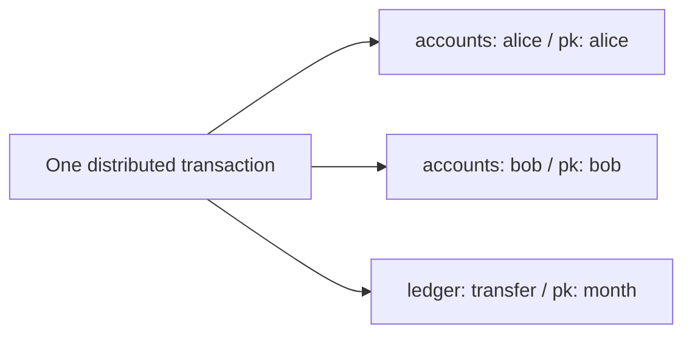

# Azure Cosmos DB distributed transaction sample

**An interactive walkthrough of atomic writes and consistent reads across Azure Cosmos DB partitions and containers.**

Azure Cosmos DB for NoSQL · Distributed transactions (public preview)

[Quick start](#quick-start) · [Walkthrough](#what-youll-learn) · [Authentication](#authentication-and-configuration) · [Container image](#optional-build-and-push-a-container-image)

## What you'll learn

Transfer money from Alice to Bob and record a ledger entry **as one atomic transaction**. The account documents live in different logical partitions; the ledger entry lives in another container.



| Step | Try this | Observe |
| --- | --- | --- |
| 1 | Reset both accounts | Both balances are written together. |
| 2 | Transfer money, then read the receipt | Two balances and one ledger entry commit together; the receipt is a consistent read. |
| 3–5 (optional) | Try insufficient funds, an ETag conflict, and a calculated transfer | See why validation and concurrency checks matter. |

> [!NOTE]
> This is a learning demo, **not a banking application**. Start with steps 1 and 2; explore the other scenarios later.

> [!IMPORTANT]
> Distributed transactions require [preview enrollment](https://aka.ms/cosmosdb/dtx-onboard) and a **provisioned-throughput** Cosmos DB account, which may incur charges. The preview has no SLA. **Do not expose this app to untrusted users**: it has no sign-in or write limits, and all visitors share the same demo accounts.

## Quick start

1. Install the [.NET 8 SDK](https://dotnet.microsoft.com/download/dotnet/8.0). Set up an [Azure Cosmos DB for NoSQL account enrolled in the distributed transactions preview](https://learn.microsoft.com/azure/cosmos-db/how-to-configure-and-use-distributed-transactions). Check the guide's prerequisites: among other restrictions, this requires provisioned throughput and a single write region.
2. Create a `banking` database and two containers:

   | Container | Partition key |
   | --- | --- |
   | `accounts` | `/pk` |
   | `ledger` | `/pk` |

3. Sign in locally with Visual Studio or the Azure CLI. Grant that developer identity the **Cosmos DB Built-in Data Contributor** *data-plane* role on `/dbs/banking` ([instructions](https://learn.microsoft.com/azure/cosmos-db/how-to-connect-role-based-access-control#grant-data-plane-role-based-access)). Azure IAM Contributor alone is not sufficient.
4. From this folder, run in PowerShell, replacing the endpoint with your account's HTTPS URI:

   ```powershell
   $env:CosmosDb__Endpoint = "https://<your-account>.documents.azure.com:443/"
   dotnet run
   ```

Open the address printed by `dotnet run`. Select **Reset both accounts**, **Transfer money**, then **Refresh snapshot**. For a read-only example, select **Read transfer receipt** after a confirmed transfer.

## Optional: Build and push a container image

<details>
<summary>Build locally and publish to Azure Container Registry</summary>

The `Dockerfile` builds a Linux .NET 8 image that listens on port `8080`. `.dockerignore` excludes `appsettings*.json`, local secrets, and build artifacts, so no local endpoint is copied into the image. Supply `CosmosDb__Endpoint` at runtime in Azure Container Apps and grant the app's managed identity Cosmos DB data-plane access.

Start Docker Desktop's Linux engine, then build and smoke-test the image locally:

```powershell
docker build -t sampledtxapp:v1 .
docker run --rm -p 8080:8080 sampledtxapp:v1
```

Open `http://localhost:8080` to check that the page loads; without runtime Cosmos DB configuration, database actions remain unavailable.

In the Azure portal, copy your registry's actual **Login server**, which might include a DNS hash when Domain Name Label protection is enabled. Sign in with an identity that has permission to push images, then tag and push the tested image:

```powershell
az login
az acr login --name <registry-resource-name>
docker tag sampledtxapp:v1 <actual-login-server>/sampledtxapp:v1
docker push <actual-login-server>/sampledtxapp:v1
```

Use the registry *resource name* for `az acr login`, not the hashed login server. In Container Apps, select the pushed image and use an identity with `AcrPull` to access the private registry. Set HTTP ingress target port to `8080` to match the container.

</details>

## More to explore (optional)

<details>
<summary>Additional walkthrough scenarios, troubleshooting, and safety notes</summary>

### Steps 1–2: Atomic writes and a consistent read

Use **Reset both accounts** to atomically upsert `alice` and `bob` with 1,000 each in different logical partitions. **Transfer money** uses the amount entered (100 by default): it reads both accounts and their ETags, checks Alice's balance, then submits two ETag-conditional balance patches and a ledger create in a single distributed write transaction. The debit also has a server-side sufficient-funds condition to guard against a balance change after the read. If either ETag has changed, refresh and try again instead of replaying the same transaction. **Refresh snapshot** performs a distributed read transaction so both balances come from one committed snapshot.

After a confirmed transfer, select **Read transfer receipt** in Step 2. The app uses that transfer's ledger ID and month partition key to read Alice, Bob, and the ledger item in **one distributed read transaction** across two partitions and containers. The receipt displays their mutually consistent snapshot and its activity ID; it does not write anything. Balances are current at the read instant, not necessarily the balances immediately after the selected transfer if other operations have run since. This button tracks the latest confirmed transfer in the current browser session; start another transfer if the session has been lost.

### Steps 3–5: Validation and concurrency

**Step 3: Insufficient funds.** Select **Prepare scenario** to atomically set Alice's balance to 300 and Bob's to 1,000. After the setup commit is confirmed, select **Attempt 500 transfer**. The app captures a consistent before snapshot, runs the normal transfer path, and captures an after snapshot. The transfer reads Alice and Bob, but the client-side balance check rejects 500 before creating or submitting any distributed *write* transaction or ledger record. The two snapshots should have identical balances if no other client changes the accounts. This demonstrates client-side pre-validation, not a server-side transaction abort. Preparing overwrites the existing demo balances; use **Reset both accounts** afterward to restore both to 1,000.

**Step 4: Interleaved write / ETag conflict.** First use **Reset both accounts** (Alice and Bob should each have at least 100). Select **Stage Alice → Bob transfer**; the Blazor page stores both ETags and a unique ledger ID but submits no transfer writes. Next, select **Change Alice (+1)**. This performs an ordinary server-side `PatchItemAsync`, outside the staged distributed transaction. It updates Alice's balance and ETag, but does not touch Bob or the ledger. Finally, select **Commit staged transfer**. The code checks that Alice's ETag actually changed, then submits two conditional patches and a ledger create using the *original* ETags. Expect operation 0 `412 PreconditionFailed`, sometimes inside a `452` aborted transaction. The page reads the accounts and that attempt's unique ledger ID afterward to check that Bob was not credited and the ledger entry was not created. Alice's balance **does** change by 1 because of the independent write. If the response times out or final status is unknown, don't retry: check the ledger and reconcile first. To retry after a confirmed abort, stage fresh reads and ETags rather than reusing the old attempt.

**Step 5: Read, calculate, conditionally write.** Reset the accounts first, then choose **Read and calculate**. One distributed read transaction captures Alice's and Bob's balances and ETags from the same committed instant. The app displays both original and proposed balances without writing anything. Optionally select **Change Alice (+1) to force a conflict** before **Submit conditional transfer**. The submission is a separate distributed write transaction that replaces both balances under their respective `IfMatchEtag` conditions and creates the ledger entry atomically. If either account changes after the read, the write must abort; on a confirmed ETag conflict select **Read fresh state & recalculate** rather than replaying the old proposal. Each new read stages a new ledger ID. A timeout or FastResponse leaves the outcome uncertain: reconcile the attempt's ledger ID and balances before considering any new attempt. This sample conditionally updates both items it read; the preview write API does not provide a read-only ETag check for other dependencies.

The conflict demo runs entirely from the interactive Blazor page; no local scripts or command-line tools are required for visitors. The Azure Cosmos DB credentials stay on the server and must never be sent to the browser. **Before publishing this app to unrestricted users**, add authentication and write limits, and isolate each visitor's demo account items: this sample currently uses shared `alice` and `bob` records, so one visitor's reset or update can disrupt another visitor's staged transaction.

### Troubleshooting

For troubleshooting, use **Test individual account writes** to upsert Alice and Bob to 1,000 with separate `UpsertItemAsync` requests. The page shows each account's status and activity ID without making a distributed transaction or snapshot request. These writes are not atomic: one account may be updated even if the other request fails. A successful test verifies item writes with the configured credential, not distributed-transaction enrollment. If you previously used this demo with `account-A` and `account-B`, those older documents remain untouched; the new buttons use `alice` and `bob`.

Every submitted transfer now displays its unique ledger ID and month partition, even when the transaction reports an abort. If a later attempt reports **452 aborted** but an earlier **408** may have committed, compare the ledger record's `id` and `createdUtc` against the attempt before attributing the balances to the aborted transaction. Do not reset or submit another transfer while the outcome is unresolved. If a ledger entry for the *same* attempt ID appears despite a reported abort, retain both activity IDs and SDK diagnostics for Azure support.

</details>

## SDK references

- [Azure Cosmos DB .NET SDK distributed transaction guide](https://learn.microsoft.com/azure/cosmos-db/how-to-configure-and-use-distributed-transactions?tabs=entra-id)
- [Azure Cosmos DB for NoSQL data-plane RBAC](https://learn.microsoft.com/azure/cosmos-db/how-to-connect-role-based-access-control)
